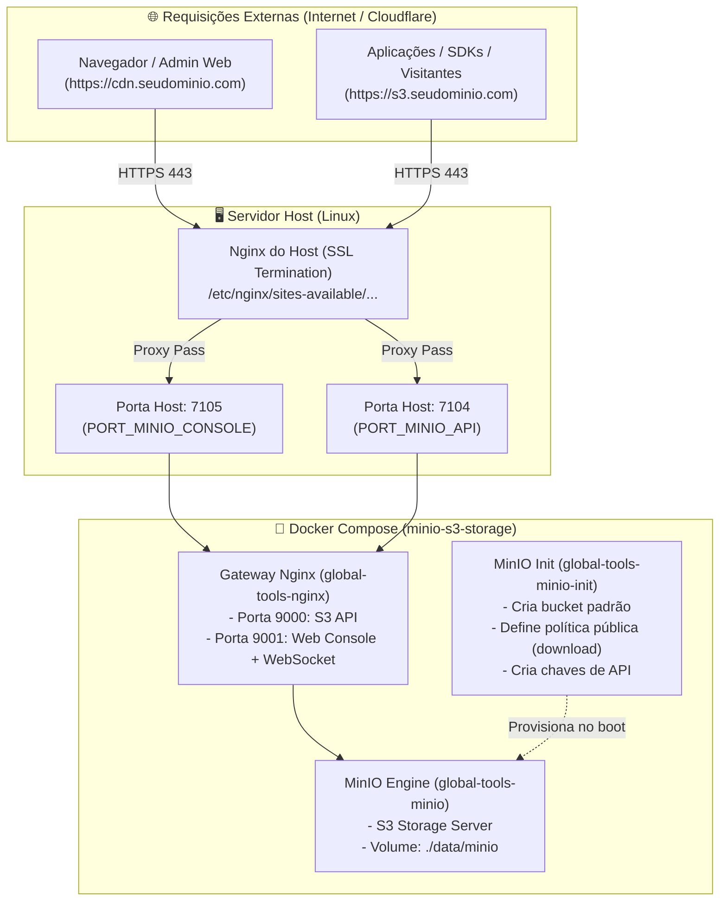

# MinIO S3 Storage & Gateway Nginx

Solução completa, padronizada e pronta para produção de **Object Storage compatível com AWS S3**, utilizando **MinIO** e um **Gateway Nginx** interno otimizado, com provisionamento automático de buckets, permissões públicas e templates de integração para proxy reverso do host.

---

## 📐 Arquitetura



---

## ✨ Recursos

- **Compatibilidade Total com AWS S3:** Pronto para uso com Laravel (`league/flysystem-aws-s3-v3`), AWS SDK PHP, Python `boto3`, Node.js AWS SDK, Go MinIO SDK e CLI oficial `mc`.
- **Painel Administrativo Web (Console):** Acesso visual completo para gerenciar buckets, objetos, usuários e métricas sob subdomínio exclusivo (ex: `https://cdn.seudominio.com`).
- **Suporte Total a WebSocket:** Comunicação em tempo real para monitoramento e métricas do MinIO Console sem desconexões.
- **Buckets com Política de Download Público:** Arquivos enviados ao bucket público podem ser visualizados ou baixados diretamente via URL HTTP(S) sem necessidade de URLs pré-assinadas (`presigned URLs`).
- **Provisionador Automático (`minio-init`):** Cria automaticamente o bucket padrão, aplica a política de download anônimo e registra as chaves de acesso no primeiro boot ou após recriação de containers.
- **Modelo de Proxy Reverso do Host:** Inclui arquivo de modelo pronto ([host-proxy.example.conf](docker/nginx/host-proxy.example.conf)) para integração direta com o Nginx do servidor.

---

## 📁 Estrutura de Arquivos

```text
minio-s3-storage/
├── .env.example                      # Template de variáveis de ambiente
├── compose.yml.example               # Template de orquestração Docker Compose
├── compose-script.sh                 # Script facilitador de execução em produção
├── data/
│   └── minio/                        # Volume persistente do armazenamento de objetos
└── docker/
    └── nginx/
        ├── conf.d/
        │   └── default.conf          # Configuração dos servidores internos (portas 9000 e 9001)
        ├── host-proxy.example.conf   # Exemplo pronto de proxy reverso para o Nginx do Host
        └── nginx.conf                # Configuração global do Nginx com mapa de WebSockets
```

---

## 🚀 Instalação e Inicialização

### 1. Clonar e preparar arquivos de ambiente

```bash
cp .env.example .env
cp compose.yml.example compose.yml
```

### 2. Configurar as variáveis no `.env`

Edite o arquivo `.env` ajustando os domínios, credenciais e configurações desejadas:

```dotenv
## Portas no Host expostas pelo Nginx interno
PORT_MINIO_API=7104
PORT_MINIO_CONSOLE=7105

## URLs públicas (externas) dos serviços
MINIO_SERVER_URL="https://s3.tiagofranca.com"
MINIO_BROWSER_REDIRECT_URL="https://cdn.tiagofranca.com"

## Credenciais do Administrador Root
MINIO_ROOT_USER=admin
MINIO_ROOT_PASSWORD='SuaSenhaForteAqui123*'

## Bucket padrão e credenciais de aplicação
MINIO_DEFAULT_BUCKET=meu-bucket-prod
MINIO_DEFAULT_ACCESS_KEY=minha_access_key
MINIO_DEFAULT_SECRET_KEY=minha_secret_key_super_segura
```

### 3. Iniciar a stack com Docker Compose

Você pode utilizar o script auxiliar ou o comando direto do Docker Compose:

```bash
# Via script auxiliar:
./compose-script.sh up -d

# Ou diretamente:
docker compose up -d
```

Verifique se todos os containers estão ativos e saudáveis:

```bash
docker compose ps
```

---

## 🌐 Configuração do Proxy Reverso no Host

Para expor os subdomínios externos em HTTPS através do Nginx principal do servidor:

1. **Ativar o mapeamento de WebSocket no Nginx do Host:**
   Crie o arquivo `/etc/nginx/conf.d/websocket.conf` com o seguinte conteúdo:
   ```nginx
   map $http_upgrade $connection_upgrade {
       default upgrade;
       '' close;
   }
   ```

2. **Copiar e ajustar o arquivo de virtual host:**
   ```bash
   sudo cp docker/nginx/host-proxy.example.conf /etc/nginx/sites-available/meudominio.conf
   ```
   Edite `/etc/nginx/sites-available/meudominio.conf`, ajustando os domínios (`s3.tiagofranca.com`, `cdn.tiagofranca.com`), caminhos dos certificados SSL e portas se necessário.

3. **Ativar e recarregar o Nginx:**
   ```bash
   sudo ln -s /etc/nginx/sites-available/meudominio.conf /etc/nginx/sites-enabled/
   sudo nginx -t && sudo systemctl reload nginx
   ```

---

## 🔗 Formato de URLs de Acesso

| Recurso | Exemplo de URL | Autenticação |
| :--- | :--- | :--- |
| **Console Web (Painel)** | `https://cdn.tiagofranca.com` | Usuário e Senha Root |
| **API S3 (Endpoint SDKs)** | `https://s3.tiagofranca.com` | Access Key & Secret Key |
| **Visualização Pública de Arquivos** | `https://s3.tiagofranca.com/{bucket}/{caminho_arquivo}` | Nenhuma (Acesso Público) |

---

## 👨‍💻 Autor

Desenvolvido por **Tiago França**.

- 🌐 **Website:** [tiagofranca.com](https://tiagofranca.com)
- 🐙 **GitHub:** [@tiagofrancafernandes](https://github.com/tiagofrancafernandes)
- 💼 **LinkedIn:** [linkedin.com/in/tiago-php](https://linkedin.com/in/tiago-php)

---

## 📄 Licença

Distribuído sob licença aberta para reutilização e implementação em múltiplos ambientes.
